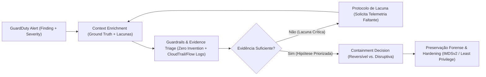

# 🛡️ AWS GuardDuty Incident Response Playbook (AI-Assisted SecOps)

[](https://aws.amazon.com/guardduty/)
[](#)
[](#)
[](#)

> **Playbook operacional e arquitetura de prompt *Evidence-Bound* para triagem de achados críticos do Amazon GuardDuty em ambientes AWS de produção.**  
> Desenvolvido por **Lucas Henrique Abreu da Rocha** (`@lcszero44-cell`) para o Desafio Criativo da DIO: *"Do Alerta à Resposta: Prompt para Investigar um Achado do Amazon GuardDuty"*.

---

## 🎯 Visão Geral da Arquitetura

Em incidentes reais de segurança na nuvem — especialmente durante plantões de madrugada com SLOs rígidos (ex.: checkout de pagamentos com SLA 99.95%) — prompts genéricos induzem LLMs a **alucinar identificadores AWS**, **ignorar impacto de negócio** ou **descartar alertas críticos como falsos positivos prematuros**.

Este repositório implementa uma arquitetura de **Triagem Forense Orientada a Evidências (*Zero-Hallucination & Evidence-Bound Triage*)**, transformando um achado bruto do Amazon GuardDuty em uma análise estruturada, auditável e segura para engenheiros de plataforma e SREs.

### Fluxo Operacional do Playbook



---

## 🧱 Construção Metodológica em 3 Passos

O playbook segue rigorosamente os três pilares de engenharia exigidos no desafio:

### Passo 1 — Definição do Achado, Persona e Decisão Operacional
- **Cenário-alvo:** `UnauthorizedAccess:IAMUser/InstanceCredentialExfiltration.OutsideAWS` (Severidade `8.5 / High`) na Role `prod-payments-checkout-ec2-role` dentro da VPC `vpc-prod-core` (`sa-east-1`).
- **Alinhamento de Persona:** A IA atua como *Engenheiro Sênior de Cloud SecOps (AWS)* escrevendo especificamente para um *SRE / Engenheiro de Plataforma de plantão*, focado em uma decisão binária de alto risco: **conter imediatamente vs. coletar telemetria antes de impactar o fluxo de pagamentos**.

### Passo 2 — Arquitetura de Contexto, Ordem Forense e Guardrails Anti-Alucinação
- **Separação Ground Truth vs. Lacunas:** Declara explicitamente os controles confirmados (CloudTrail multi-região, VPC Flow Logs, IMDSv1 ainda permitido) e o que **ainda não foi inspecionado** (`EventName` no CloudTrail, SSRF, SSM).
- **Ordem Obrigatória em 5 Blocos:**
  1. Resumo Executivo em linguagem direta
  2. Matriz de Hipóteses ranqueadas por probabilidade
  3. Plano de Verificação Forense (Evidência que confirma/descarta × Serviço AWS exato)
  4. Plano de Contenção Escalonado (Reversível vs. Irreversível, com declaração de impacto no checkout)
  5. Checklist de Lacunas para encerramento seguro
- **Guardrails Invioláveis:** *Zero Invenção* de IDs/IPs/contas, rotulagem explícita de `[HIPÓTESE]`, proibição de falso positivo prematuro e *Protocolo de Lacuna* obrigatório.

### Passo 3 — Testes de Estresse, Edge Cases e Refinamento
O prompt foi submetido a uma bateria de três casos de teste desenhados para expor falhas clássicas de LLMs em SecOps (viés de confirmação, descarte prematuro em janelas de manutenção e invenção de telemetria ausente).

---

## 📂 Estrutura do Repositório

```text
AWS-GuardDuty-Playbook/
├── README.md                                       # Vitrine técnica e arquitetura do playbook
├── guardduty-ir-prompt.md                          # Prompt Mestre oficial + guia completo (Passos 1, 2 e 3)
└── test-cases/
    ├── 01-compromised-iam-production.md            # Cenário principal: exfiltração EC2 via SSRF/IMDSv1
    ├── 02-ambiguous-root-migration.md              # Caso ambíguo: RootCredentialUsage em janela de manutenção
    └── 03-missing-telemetry-edge-case.md           # Teste de estresse: dados ausentes & bloqueio de alucinação
```

### 🔗 Links Rápidos

| Artefato | Propósito | Foco de Validação |
| :--- | :--- | :--- |
| **[`guardduty-ir-prompt.md`](./guardduty-ir-prompt.md)** | Entregável oficial com o Prompt Mestre pronto para uso e documentação técnica completa | Arquitetura completa (Passos 1, 2 e 3) + Matriz de Contenção |
| **[`test-cases/01-compromised-iam-production.md`](./test-cases/01-compromised-iam-production.md)** | Triagem do incidente crítico de exfiltração de credencial IAM em produção | Ordem forense, IMDSv1/SSRF, proteção ao SLA 99.95% |
| **[`test-cases/02-ambiguous-root-migration.md`](./test-cases/02-ambiguous-root-migration.md)** | Alerta `Policy:IAMUser/RootCredentialUsage` durante janela de mudança planejada | Bloqueio de falso positivo prematuro e exigência de prova no CloudTrail |
| **[`test-cases/03-missing-telemetry-edge-case.md`](./test-cases/03-missing-telemetry-edge-case.md)** | Prompt pressionado por dados não fornecidos (país do IP, Instance ID, Account ID) | Guardrail *Zero Invenção* e ativação do *Protocolo de Lacuna* |

---

## 🚀 Como Usar em um Incidente Real

1. Abra [`guardduty-ir-prompt.md`](./guardduty-ir-prompt.md) e copie o bloco **Prompt Mestre**.
2. Substitua os campos da **Seção 1 (Dados do Achado)** e **Seção 3 (Contexto Confirmado e Lacunas)** com os dados reais do seu console AWS GuardDuty.
3. Execute no seu LLM corporativo de preferência — **não remova as Seções 4 e 5**, pois elas garantem a rastreabilidade forense e impedem alucinações.
4. Execute primeiro as consultas **somente leitura** (CloudTrail, CloudWatch `MetadataNoToken`, VPC Flow Logs) e realimente o modelo com as evidências coletadas antes de disparar ações disruptivas.

---

## 👤 Autor

**Lucas Henrique Abreu da Rocha**  
GitHub: [`@lcszero44-cell`](https://github.com/lcszero44-cell)  
Repositório: [`aws-guardduty-incident-playbook`](https://github.com/lcszero44-cell/aws-guardduty-incident-playbook)
